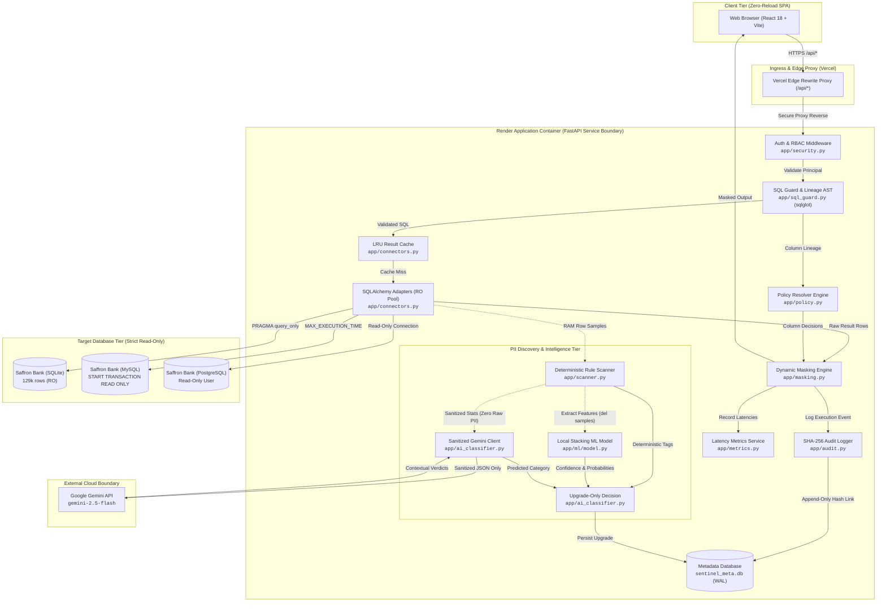
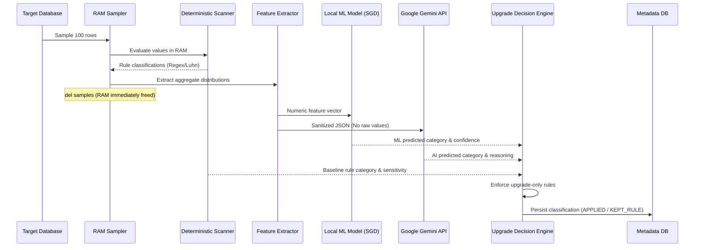

# DreamGuard — System Architecture

> **Document Version:** 1.0.0  
> **Target Evaluation Environment:** Hackathon AI Evaluation / Production Cloud Deployment  
> **Repository Base:** `FULL_CODE/backend/app`, `FULL_CODE/frontend/src`, `render.yaml`, `Dockerfile`  

---

## 1. High-Level Architecture Overview

DreamGuard operates as a secure enforcement proxy and data privacy gateway. It intercepts client requests, parses SQL into abstract syntax trees (AST), enforces fine-grained column policies, executes queries against target databases strictly read-only, masks sensitive values dynamically on the server, and cryptographically commits the execution trace to an append-only audit log before delivering results.



---

## 2. Ingress & Deployment Architecture

DreamGuard supports unified local development as well as production cloud deployment across Vercel and Render:

```
[Web Browser]
      │
      ▼ (HTTPS)
[Vercel Edge Network]
  ├── Serves Static SPA Assets (HTML, CSS, JS bundles)
  └── Rewrites /api/* ───> [Render Backend Container] (FastAPI Uvicorn)
```

1. **Frontend Hosting (Vercel):**
   - Built with Vite as a pure static Single Page Application (`dist/`).
   - Configured in `FULL_CODE/frontend/vercel.json`:
     ```json
     {
       "rewrites": [
         { "source": "/api/:path*", "destination": "https://dreamguard-api.onrender.com/api/:path*" },
         { "source": "/(.*)", "destination": "/index.html" }
       ]
     }
     ```
   - Eliminates CORS pre-flight latency for browser clients.
   - Preserves first-party cookie semantics (preventing browser third-party cookie restrictions).

2. **Backend Hosting (Render):**
   - Configured in `render.yaml` and `Dockerfile`.
   - Runs `python -m uvicorn app.main:app --host 0.0.0.0 --port 10000`.
   - Self-contained container environment bundling SQLite target databases, pre-trained ML models, and configuration.

---

## 3. Core Backend Components

### 3.1 Authentication & Principal Resolution (`app/security.py`)
- **Authentication Mechanisms:** Supports both `sentinel_session` HTTP cookies and `Authorization: Bearer <token>` headers.
- **Session Security:** Raw session tokens (32 random hex bytes) are never stored in the database. Only their SHA-256 digests (`token_hash`) are persisted in `sessions`.
- **Principal Object:** Resolved per-request by FastAPI dependency injection (`Depends(current_principal)`):
  - `user_id`: Unique identifier
  - `username`: Account name
  - `role`: Role string (`admin`, `support`, `analyst`, `compliance`)
  - `permissions`: Set of granular privileges (e.g. `query:execute`, `audit:read`, `scan:run`, `raw:break_glass`)

### 3.2 SQL Guard & AST Validator (`app/sql_guard.py`)
The SQL Guard uses `sqlglot` to parse incoming SQL queries into an Abstract Syntax Tree (AST) before database execution:
- **Statement Whitelisting:** Permits only `SELECT` statements; immediately rejects `INSERT`, `UPDATE`, `DELETE`, `DROP`, `ALTER`, `CREATE`, and `PRAGMA`.
- **System Catalog Protection:** Rejects queries targeting metadata tables (e.g., `sqlite_master`, `information_schema`, `pg_catalog`).
- **Table-Level Authorization:** Resolves all referenced tables from the AST and verifies the principal has an active `TableGrant` for that connection.
- **Lineage Tracking:** Resolves every output column back to its source table and column, even through aliases, joins, or expressions.
- **Enforced Safety Rewrites:**
  - Injects `LIMIT <max_result_rows>` (default 500) if no limit is present or if the client requests an excessive limit.
  - Automatically qualifies schema names (`schema.table`) when connected to multi-schema backends like MySQL or PostgreSQL.
  - Enforces minimum group size ($k \ge 5$) on aggregate grouping queries to prevent differential privacy reconstruction attacks.

### 3.3 Dynamic Policy Resolution (`app/policy.py`)
For every output column in the validated AST, the `PolicyResolver` computes an enforcement decision based on a strict 4-level precedence cascade:

```
[Column Decision Precedence]
1. Column-Specific Policy  (table + column + role)       -> Highest Precedence
2. Category Policy         (PII category + role)
3. Default Sensitivity     (CONFIDENTIAL / RESTRICTED)
4. Base Role Default       (Public ALLOW / Fail Closed)  -> Fallback
```

**Actions:**
- `ALLOW`: Raw value returned (e.g., non-sensitive reference tables or Admin unmasking).
- `PARTIAL`: Deterministic masking retaining partial structure (e.g., credit card last 4 digits `4111-XXXX-XXXX-1111`, phone suffix `********1099`, email domain `a****@example.com`).
- `HASH_HMAC`: Cryptographic pseudonymization using HMAC-SHA-256 with server-side key. Preserves equality and foreign key joins across queries without revealing the original plaintext.
- `REDACT`: Replaces value with `[REDACTED]`.
- `DROP`: Omits or zeroes out the value (e.g., account balance aggregate-only enforcement).

### 3.4 Read-Only Database Adapters & Cache (`app/connectors.py`)
- **Connection Isolation:** SQLAlchemy connection pool manages connections per registered `DbConnection`.
- **Enforced Read-Only Transactions:**
  - **SQLite:** Executes `PRAGMA query_only = ON` on every connection check-out.
  - **MySQL:** Executes `START TRANSACTION READ ONLY` and sets `SET SESSION MAX_EXECUTION_TIME = <ms>`.
  - **PostgreSQL:** Uses dedicated read-only role credentials (`sentinel_app`).
- **In-Memory LRU Result Cache (`execute_cached`):**
  - Thread-safe `OrderedDict` with TTL and maximum item limits.
  - Caches raw database query results keyed on SQL hash.
  - **Security Guarantee:** On a cache hit, cached raw rows are *never* returned directly. Instead, they pass through the caller's specific `PolicyResolver` and `MaskingEngine`, ensuring a support user cannot view data cached by an admin query.

### 3.5 Cryptographic Tamper-Evident Audit System (`app/audit.py`)
Every query execution, authentication attempt, classification review, and discovery scan is recorded in `audit_events`.
- **SHA-256 Hash Chaining:**
  $$\text{entry\_hash} = \text{SHA256}(\text{prev\_hash} \,||\, \text{ts} \,||\, \text{actor\_id} \,||\, \text{role} \,||\, \text{action} \,||\, \text{outcome} \,||\, \text{details\_json})$$
- **Database Trigger Protection:** SQLite database triggers (`audit_no_update` and `audit_no_delete`) block any SQL attempt to modify or delete historical audit entries.
- **SQL Sanitization:** Statements recorded in the audit log have all literals replaced with `?` via `sqlglot` placeholder transformation (`redact_sql_literals`), ensuring that sensitive values typed in `WHERE` clauses never leak into audit logs.

---

## 4. PII Discovery & Intelligence Pipeline



1. **Step 1: In-Memory Sampling**
   - Retrieves random row samples (default 100) per table directly into memory.
   - Raw sample arrays are deleted (`del samples`) immediately after feature extraction. Raw samples are never written to disk or transmitted across network boundaries.

2. **Step 2: Deterministic Rule Scanner (`app/scanner.py`)**
   - Fast regex and checksum algorithms evaluate sample strings.
   - Validates Credit Cards (Luhn algorithm), Aadhaar (Verhoeff checksum), Indian PAN, US SSN, Passports, IBAN, IFSC, Emails, Phone numbers, and IP addresses.

3. **Step 3: Sanitized Feature Extraction (`app/ai_features.py`)**
   - Computes column metadata without raw data: character ratios (alpha, digit, symbol, whitespace), null ratios, uniqueness ratios, length statistics (min, max, mean, median), and regex match proportions.

4. **Step 4: Local Stacking Machine Learning Classifier (`app/ml/model.py`)**
   - Runs 100% in-process via scikit-learn and joblib. Zero network dependency, zero API cost.
   - Stacks TF-IDF character n-grams of table/column names (Logistic Regression) with gradient-boosted trees on sanitized statistics, calibrated via 5-fold isotonic calibration.

5. **Step 5: Contextual Gemini Detection (`app/ai_classifier.py`)**
   - Sends the sanitized feature JSON to Gemini 2.5/3.8 Flash using structured JSON schema response constraints.
   - Provides contextual reasoning for ambiguous column headers (e.g. identifying `mob_no` as Phone or `cust_nm` as Customer Name).

6. **Step 6: Upgrade-Only Decision Arbitration (`ai_classifier.py:upgrade_decision`)**
   - Protects against model hallucinations and regressions.
   - Mathematical hierarchy: AI/ML can **only elevate** sensitivity rank (e.g. upgrading an unclassified column to PII, or upgrading `INTERNAL` to `RESTRICTED`).
   - If AI/ML suggests a lower sensitivity than the deterministic rule, the rule is retained (`KEPT_RULE`).
   - If a human administrator previously approved or edited the column, the human verdict is preserved (`HUMAN_REVIEWED`).

---

## 5. Trust Boundaries & Security Enclaves

```
+─────────────────────────────────────────────────────────────────────────────+
| TRUST BOUNDARY 1: Web Browser Sandbox                                       |
| - React 18 Single Page Application                                          |
| - First-party session cookie or Bearer token storage                        |
| - Renders only masked JSON returned by API                                  |
+─────────────────────────────────────────────────────────────────────────────+
                                       │ HTTPS
                                       ▼
+─────────────────────────────────────────────────────────────────────────────+
| TRUST BOUNDARY 2: Vercel Edge Proxy                                         |
| - Edge reverse proxy rewriting /api/* to Render backend                     |
| - Drops unauthorized request headers                                        |
+─────────────────────────────────────────────────────────────────────────────+
                                       │ HTTPS / mTLS
                                       ▼
+─────────────────────────────────────────────────────────────────────────────+
| TRUST BOUNDARY 3: Render Application Container (FastAPI Backend)            |
| - Session validation & RBAC privilege checking                             |
| - SQL Guard AST parsing & parameterization                                  |
| - Dynamic masking engine (HMAC secrets stored in data/secrets)              |
| - Ephemeral sample buffer: row values discarded via del samples             |
| - SQLite Metadata DB (sentinel_meta.db) with WAL mode & DB triggers         |
+─────────────────────────────────────────────────────────────────────────────+
           │                                                │
           │ Sanitized Stats Only                           │ Read-Only Queries
           ▼ (Zero Raw PII Egress)                          ▼ (START TRANSACTION RO)
+──────────────────────────────────────+     +────────────────────────────────+
| TRUST BOUNDARY 4: Google Gemini API  |     | TRUST BOUNDARY 5: Target DBs   |
| - Remote external AI cloud           |     | - SQLite / MySQL / PostgreSQL  |
| - Receives: lengths, ratios, regex   |     | - Hard query timeouts          |
| - NEVER receives: raw customer rows  |     | - Enforced row count caps      |
+──────────────────────────────────────+     +────────────────────────────────+
```

---

## 6. Component-to-Source-File Mapping

| Architectural Component | Implementation Files | Primary Responsibilities |
|---|---|---|
| **API Entrypoint & Middleware** | `app/main.py`<br>`app/config.py` | FastAPI application initialization, CORS configuration, exception handling, gzip compression. |
| **Authentication & RBAC** | `app/security.py`<br>`app/api/auth.py` | Session creation, password hashing (bcrypt), token validation, principal dependency injection. |
| **SQL Guard & Query Planner** | `app/sql_guard.py`<br>`app/query_engine.py` | `sqlglot` AST parsing, syntax validation, lineage resolution, LIMIT injection, schema qualification. |
| **Policy Engine & Masking** | `app/policy.py`<br>`app/masking.py` | Precedence-based rule resolution, HMAC-SHA-256 pseudonyms, partial string masking, value redaction. |
| **Database Connectivity** | `app/connectors.py`<br>`app/saffron.py`<br>`app/api/databases.py` | SQLAlchemy read-only connection pooling, dialect adapters, result caching, sampling. |
| **Deterministic Rule Scanner** | `app/scanner.py`<br>`app/entities.py` | Regex patterns, checksum algorithms (Luhn, Verhoeff), data type heuristics. |
| **Machine Learning Engine** | `app/ml/model.py`<br>`app/ml/featurize.py`<br>`app/ml/train.py` | In-process inference, numeric feature generation, TF-IDF n-gram name model, joblib serialization. |
| **Cloud AI Integration** | `app/ai_classifier.py`<br>`app/ai_features.py` | Sanitized feature extraction, Gemini API client, response schema validation, upgrade arbitration. |
| **Cryptographic Audit** | `app/audit.py`<br>`app/api/audit_api.py` | SHA-256 event hash chaining, literal redaction, tamper-detection verification. |
| **Database Integrity** | `app/integrity.py`<br>`app/saffron.py` | Per-table row fingerprinting, pre- and post-query hash comparisons. |
| **Document PII Scanner** | `app/uploads.py`<br>`app/api/uploads.py` | File parsing (PDF, DOCX, TXT, CSV), in-memory PII extraction, import staging. |
| **Metadata Database** | `app/metadb.py`<br>`app/seed.py` | SQLAlchemy ORM models, WAL mode configuration, immutability triggers, seed datasets. |

